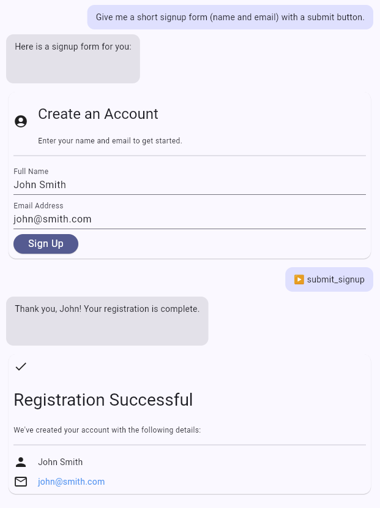

[](https://pub.dev/packages/genkit_a2ui)

# genkit_a2ui

A Genkit Dart plugin that brings [A2UI](https://a2ui.org/) ("Agent to UI"), a
transport-agnostic, JSON-based streaming UI protocol, to Genkit agents.

An A2UI-enabled agent can stream more than prose. It streams rich, interactive UI
**surfaces** (cards, lists, forms, buttons) that a client renders incrementally
as the model responds. The whole server-side integration is a single model
middleware: add `a2ui()` to an agent's `use` list and nothing else changes.

[Documentation](https://genkit.dev) • [API Reference](https://pub.dev/packages/genkit_a2ui) • [A2UI Specification](https://a2ui.org/)



> Status: experimental.

> **Building with a coding agent? Install the Genkit Dart skill first.**
>
> ```bash
> npx skills add genkit-ai/skills --skill developing-genkit-dart
> ```
>
> It teaches your agent the current Genkit Dart APIs and common gotchas.
> Source, manual install and skills for other languages:
> [genkit-ai/skills](https://github.com/genkit-ai/skills).

## Installation

Add the plugin to the package that runs your agent (it is server-side only):

```bash
dart pub add genkit_a2ui
```

Keep it out of a genui app's pubspec: genkit_a2ui depends on `a2ui_core` 0.5
and genui 0.10.x on `a2ui_core` 0.1, so the two cannot resolve together. Run
the agent in its own package (a server, as in the sample); an app that hosts
the agent in-process and renders with genui has to wait for genui to move to
`a2ui_core` 0.5.

The client does not depend on `genkit_a2ui`. To render surfaces it needs
`package:genkit` and a renderer. The Dart examples below use
[`genui`](https://pub.dev/packages/genui), the Flutter renderer for A2UI
surfaces, which takes messages typed by `a2ui_core`. Use genui 0.10.3 or later:
earlier versions use a different id for the basic catalog and render blank
surfaces.

```bash
flutter pub add genkit 'genui:^0.10.3' a2ui_core
```

## Quickstart

### 1. Add the middleware on the server

Add `a2ui()` to your agent's `use` list. That is the entire server-side setup.

Unlike the JS plugin, Dart middleware is resolved by name from the registry, so
you must register `A2uiPlugin()` in `Genkit(plugins: [...])` before referencing
it via `a2ui()`.

```dart
import 'package:genkit/experimental.dart'; // defineAgent
import 'package:genkit/genkit.dart';
import 'package:genkit_a2ui/a2ui.dart';
import 'package:genkit_google_genai/genkit_google_genai.dart';

final ai = Genkit(
  plugins: [googleAI(), A2uiPlugin()],
);

final uiAgent = ai.defineAgent(
  name: 'uiAgent',
  model: googleAI.gemini('gemini-flash-latest'),
  system: 'You help users. Render UI when it is clearer than prose.',
  use: [a2ui()], // <- A2UI support (defaults to the bundled 'basic' catalog)
);
```

It works the same on a one-shot `generate`:

```dart
final res = await ai.generate(
  model: googleAI.gemini('gemini-flash-latest'),
  prompt: 'Show me the weather in Tokyo',
  use: [a2ui()],
);
```

### 2. Render surfaces on the client

The client does **not** depend on `genkit_a2ui`. A2UI arrives as plain,
spec-shaped data parts (see [Wire format](#wire-format)), so a client needs only
`package:genkit` and a renderer. Keeping this package off the client also means
it can never hold back the renderer version you use.

Copy these two helpers into your app:

```dart
import 'dart:convert';

import 'package:genkit/client.dart';
// genui also exports `Part`/`DataPart`, so take only what is needed.
import 'package:genui/genui.dart' show ChatMessage, UiPartExtension;

const a2uiMimeType = 'application/a2ui+json';

/// The A2UI messages carried by a chunk's or message's parts.
Iterable<Map<String, dynamic>> a2uiMessagesFrom(List<Part>? parts) sync* {
  for (final part in parts ?? const <Part>[]) {
    if (part.metadata?['mimeType'] != a2uiMimeType) continue;
    // `envelopes` is the pre-spec key, still written by older agents. Malformed
    // payloads are skipped rather than throwing mid-stream.
    final data = part.data;
    if ((data?['messages'] ?? data?['envelopes']) case final List messages) {
      yield* messages.whereType<Map>().map((m) => m.cast<String, dynamic>());
    }
  }
}

/// Turns a genui surface submission (e.g. a button press) into the next agent
/// input, or null when it carries no user action: genui also reports renderer
/// errors through `onSubmit`, and those are not turns. genui already emits
/// spec-shaped `{version, action}` messages, so they are forwarded untouched.
Message? a2uiSubmitToMessage(ChatMessage submit) {
  final actions = <Map<String, dynamic>>[
    for (final part in submit.parts)
      if (part.asUiInteractionPart case final ui?)
        if (_decodeJson(ui.interaction) case final Map<String, dynamic> m
            when m.containsKey('action'))
          m,
  ];
  if (actions.isEmpty) return null;
  return Message(
    role: Role.user,
    content: [
      DataPart(
        data: {'messages': actions},
        metadata: {'mimeType': a2uiMimeType},
      ),
    ],
  );
}

Object? _decodeJson(String source) {
  try {
    return jsonDecode(source);
  } on FormatException {
    return null;
  }
}
```

Then consume the agent with `remoteAgent` and feed each message to
[`genui`](https://pub.dev/packages/genui):

```dart
import 'package:a2ui_core/a2ui_core.dart' as core;
import 'package:genkit/experimental_client.dart';
import 'package:genui/genui.dart' show BasicCatalogItems, SurfaceController;

final agent = remoteAgent(url: '/api/uiAgent');
final chat = agent.chat();

// genui registers an empty stub for a catalog id it does not know, so the id
// must match the catalog the agent uses. This is genui's own basicCatalogId,
// which is the same URL as the plugin's bundled basic catalog.
final surfaceController = SurfaceController(
  catalogs: [BasicCatalogItems.asCatalog()],
);

Future<void> runTurn(AgentTurn turn) async {
  await for (final chunk in turn.stream) {
    for (final m in a2uiMessagesFrom(chunk.raw.modelChunk?.content)) {
      // One message the renderer cannot parse (a newer protocol version, say)
      // must not stop the rest of the turn.
      try {
        surfaceController.handleMessage(core.A2uiMessage.fromJson(m));
      } on Object catch (e) {
        print('skipping an A2UI message: $e');
      }
    }
  }
}

// A surface action (e.g. a button press) becomes the next turn. Listen before
// the first turn: onSubmit is a broadcast stream, so a press with no listener
// is lost. A real app should also keep turns from overlapping (the sample
// ignores presses while a turn is running).
surfaceController.onSubmit.listen((submit) {
  if (a2uiSubmitToMessage(submit) case final message?) {
    runTurn(chat.sendStream(message: message));
  }
});

await runTurn(chat.sendStream(text: 'weather in Tokyo'));
```

> See
> [`testapps/a2ui`](https://github.com/genkit-ai/genkit-dart/tree/main/testapps/a2ui)
> for a complete, runnable sample: a `dart:io` server hosting the agent, plus a
> Flutter client that renders surfaces with `genui`.

## Options

Pass options to `a2ui()` to control the catalog, prompt injection, and
validation:

| Option         | Default    | Description                                                                                                                                                      |
| -------------- | ---------- | ---------------------------------------------------------------------------------------------------------------------------------------------------------------- |
| `catalog`      | `'basic'`  | The id of the catalog describing what the agent may render.                                                                                                     |
| `instructions` | `'system'` | Where to inject catalog capabilities. `'none'` injects nothing.                                                                                                 |
| `validate`     | `'warn'`   | What to do with a block that fails to compile or validate. `'warn'` logs and drops it; `'strict'` throws; `'off'` checks only that the block compiles, not the component tree (references, `root`). |
| `version`      | `'v0.9'`   | A2UI protocol version. Only `'v0.9'` is supported.                                                                                                              |
| `repair`       | `true`     | Ask the model once to fix a block that failed to compile. Costs an extra call on the failure path only; see [Self-repair](#self-repair).                        |

### Surfaces

The model names each surface (`surface("tokyo-weather")`) and the id reaches the
client unchanged. Rendering an id again **replaces** that surface: the
middleware puts a `deleteSurface` in front of every `createSurface`, since
renderers reject a second `createSurface` for a live id. For a new surface the
delete is a no-op, so this holds even when the server's history misses a surface
the client has (a turn that failed after streaming one, say). Custom renderers
should treat a `deleteSurface` for an unknown id as a no-op too.
A block that omits `surface()` targets `default_surface`, so such blocks replace
each other.

A block without `root` **updates** a live surface instead: it carries only what
changed, as `updateComponents` / `updateDataModel` messages for that surface.

```text
surface("tokyo-weather")
$/temp = "21°C"
```

Every block is checked against the surfaces the conversation's history left on
the client, so an update must target a live surface and leave its component
tree valid. Send a2ui parts back with the history (as `remoteAgent` and session
stores do) for this to work.

In a chat UI, key each rendered surface by its id. A replaced surface then
re-renders where it first appeared, and an updated one changes in place.

### Self-repair

Models occasionally emit a block that does not compile, most often by putting a
label where a component id belongs:

```text
refresh = Button("Refresh", "primary", Event("refresh"))
```

`Button.child` is a component id, so that would render nothing useful. When a
block fails to compile the middleware sends a follow-up call containing the
error, the Express contract with the catalog's signatures (a few thousand input
tokens with the basic catalog), and the failed block, then compiles the reply.
If it works the surface renders (and the repaired block is what gets replayed
as history); if not, the block is dropped as before. That is one call per
distinct broken block, at most 3 per model call and 30 seconds in total.

This costs extra model calls **on the failure path only**. It also changes what
`validate: 'strict'` reports: it throws only if the repair fails too. To see
the model's own mistakes while developing, turn repair off:

```dart
use: [a2ui(validate: 'strict', repair: false)]
```

Repair runs once the model's response is complete, since the streaming callback
cannot wait for a second model call. The repaired surface is then sent as the
last chunk of the stream (and is in the final message), so it arrives at the
end of the turn rather than where the model wrote it. The repair call uses the
same model config as the turn (so a per-request API key still applies; an
option that forces JSON output or a function call can make the repair fail, in
which case the block is dropped as before; provider-side tools enabled in the
config, such as code execution, stay on too). Its token usage is added to the
turn's `usage`; `latencyMs` stays that of the turn's own call. Cancelling the
turn cancels a repair in flight.

## Handling user actions

When a user interacts with a surface (for example, presses a `Button`), the
renderer emits an action. Send it back as an a2ui data part carrying an
`action` message (`a2uiSubmitToMessage` above does this for genui). The
middleware turns it into a line the model can read, for example
`[UI action "refresh" from refreshBtn on surface tokyo-weather context={"city":"Tokyo"}]`, so
no accompanying text is needed.

### Forms

Input components (`TextField`, `CheckBox`, `Slider`) do **not** send their values
automatically. To capture what the user entered, the model must:

1. Bind each input's value to a data-model path:
   `email = TextField("Email", $/email)`.
2. Echo those same paths in the submit button's event context:
   `Event("submit", {email: $/email})`.

The catalog capabilities injected into the system prompt already instruct the
model to do this. Without both steps, the action arrives with an empty `context`.

### Renderer requirements

genui registers an empty stub for a catalog id it does not recognize, so a
surface whose `catalogId` the client does not hold renders as a blank. The
client's catalog ids must match the server's: genui's basic catalog (0.10.3 and
later) already uses the bundled basic catalog's id, and a custom catalog needs the same id on both
sides:

```dart
final catalog = BasicCatalogItems.asCatalog().copyWith(
  newItems: [myCustomItem],
  catalogId: 'https://my-app.org/catalogs/custom.json',
);
```

See
[`testapps/a2ui`](https://github.com/genkit-ai/genkit-dart/tree/main/testapps/a2ui)
for the full wiring.

## Wire format

A2UI travels on its own part channel, following the
[A2UI extension spec](https://a2ui.org/specification/v0.9.1-a2ui-extension-specification/):
a Genkit `data` part tagged `application/a2ui+json`. The spec puts the message
list directly in `data`; a Genkit `data` must be an object, so the list sits
under the spec's `messages` wrapper.

Agent to client (one part per rendered block):

```json
{
  "data": {
    "messages": [
      { "version": "v0.9", "deleteSurface": { "surfaceId": "tokyo-weather" } },
      { "version": "v0.9", "createSurface": { "surfaceId": "tokyo-weather", "catalogId": "https://a2ui.org/specification/v0_9/catalogs/basic/catalog.json" } },
      { "version": "v0.9", "updateComponents": { "surfaceId": "tokyo-weather", "components": [ { "id": "root", "component": "Text", "text": "Sunny, 18C" } ] } }
    ]
  },
  "metadata": {
    "mimeType": "application/a2ui+json",
    "a2uiExpress": "surface(\"tokyo-weather\")\nroot = Text(\"Sunny, 18C\")"
  }
}
```

Client to agent (a user action):

```json
{
  "data": {
    "messages": [
      { "version": "v0.9", "action": { "name": "refresh", "surfaceId": "tokyo-weather", "sourceComponentId": "refreshBtn", "timestamp": "2026-01-15T12:00:00Z", "context": { "city": "Tokyo" } } }
    ]
  },
  "metadata": { "mimeType": "application/a2ui+json" }
}
```

Earlier versions of this package used `envelopes` instead of `messages`; the
middleware still reads them when replaying history.

## Custom catalogs

The `catalog` option is a **catalog id** resolved from the Genkit registry. The
bundled `'basic'` catalog is the default and needs no registration.

To match your own layout elements and design system, define a custom catalog,
register it with `loadCatalog`, and reference it by id.

### Catalog format

Catalogs use the A2UI specification's
[`catalog.json`](https://a2ui.org/specification/v0_9/catalogs/basic/catalog.json)
format, so a published catalog loads unmodified:

- `catalogId`: A globally unique URI identifying the catalog (used as
  `catalogId` on `createSurface`).
- `components`: An object keyed by component name, where each value is the
  component's JSON Schema. The schema's `description` and property
  descriptions are what the model sees.
- `functions` (optional): Client functions (validation checks, formatters),
  keyed by name.

Property order matters: A2UI Express is positional, so the model writes
`Banner("Disk almost full", "warning")` and the order of a component's
properties decides which argument is which.

### Option A: load from a JSON file

Create a JSON file (for example `./my-catalog.json`):

```json
{
  "catalogId": "https://my-app.org/catalogs/custom.json",
  "components": {
    "Banner": {
      "type": "object",
      "description": "Displays a prominent alert banner at the top of a section.",
      "properties": {
        "component": { "const": "Banner" },
        "title": {
          "$ref": "https://a2ui.org/specification/v0_9/common_types.json#/$defs/DynamicString"
        },
        "severity": { "type": "string", "enum": ["info", "warning", "error"] }
      },
      "required": ["component", "title"]
    }
  }
}
```

Then register it under a lookup identifier (for example `'my-catalog'`) on the
server:

```dart
import 'package:genkit_a2ui/a2ui.dart';

await loadCatalog(
  ai,
  id: 'my-catalog',
  file: './my-catalog.json',
);
```

### Option B: in-memory definition

`A2uiCatalogComponent.simple` builds the same schema from a parameter list, so
you do not have to write JSON Schema by hand. Extend the bundled basic catalog
to keep its standard components:

```dart
import 'package:genkit_a2ui/a2ui.dart';

final myCatalog = basicCatalog.extend(
  id: 'https://my-app.org/catalogs/custom.json',
  components: [
    A2uiCatalogComponent.simple(
      name: 'Banner',
      description: 'Displays a prominent alert banner at the top of a section.',
      params: [
        // A literal or a data binding (`$/path`).
        const A2uiParam.dynamicValue('title', required: true),
        // A literal only, restricted to these values.
        const A2uiParam.string(
          'severity',
          enumValues: ['info', 'warning', 'error'],
        ),
      ],
    ),
  ],
);

await loadCatalog(
  ai,
  id: 'my-catalog',
  catalog: myCatalog,
);
```

`A2uiParam.dynamicValue` takes a string unless you set its `type`
(`A2uiDynamicType.number`, `.boolean`, `.stringList` or `.value`). The other
parameter kinds are `A2uiParam.number`, `A2uiParam.boolean`, `A2uiParam.child`
(one child component id), `A2uiParam.children` (a list of child ids) and
`A2uiParam.action` (an event fired on interaction), and `A2uiParam.schema` for a
property with a hand-written JSON Schema. Pass `checkable: true` for inputs that
accept validation checks. Catalog-wide guidance for the model goes
in `instructions`, as in a `catalog.json`.

### Using a registered catalog

Once registered, reference the lookup id in your `a2ui()` options:

```dart
final uiAgent = ai.defineAgent(
  name: 'uiAgent',
  model: googleAI.gemini('gemini-flash-latest'),
  use: [a2ui(catalog: 'my-catalog')],
);
```

Catalogs live in the registry (value type `a2ui-catalog`) so the middleware can
resolve them by id.

## Security and the trust boundary

Generative UI moves model output into the UI, so treat every surface an agent
emits as **untrusted input**. Every block is compiled and checked against the
catalog's schemas (component names, property types, enum values, component
references), but that only says the surface is *well-formed*. Model-controlled
values such as `Image.url` and `Text` (inline Markdown, which a renderer may turn
into rich content) pass through as written. Validation is a well-formedness
check, not a security boundary.

A prompt-injected or simply mistaken model can therefore emit an arbitrary remote
image URL, or Markdown that a renderer turns into formatted content. To keep that
safe:

- **The renderer/catalog owns prop sanitization.** Whatever renders a surface
  (for example `genui` plus your Markdown renderer) is responsible for escaping
  and sanitizing prop values before they reach the UI. If you ship a custom
  catalog, its renderer must sanitize its own components' props.
- **Restrict remote sources at the host.** On the web, serve the app with a
  Content Security Policy that limits `img-src` (and other fetch directives) to
  origins you trust, so a model-supplied image or link URL cannot exfiltrate data
  or load unexpected content.
- **Do not put secrets in the data model.** Anything bound into a surface's data
  model can be echoed back through an action's `context`.

If you need server-side control over props (for example, allow-listing image
hosts), add your own model middleware **before** `a2ui()` in `use` (middleware
listed first wraps the ones after it, so it sees the parts `a2ui()` emits) to
inspect and rewrite them. If you change a part's `data.messages`, also update or
remove its `metadata.a2uiExpress`: that source is what the model is shown on
later turns.

## How it works

### One representation

A2UI rides on its own part channel (see [Wire format](#wire-format)), which maps
1:1 onto the A2A binding of the A2UI spec, so an A2A or MCP binding can drop in
later for free.

- A **mixed** turn is a message whose content is `[textPart, a2uiPart, ...]`.
- A **pure-surface** turn is the special case with no text parts.
- Downstream consumers (the client helpers, `genui`) only ever see a2ui parts.
  "Pure vs mixed" is a prompting choice, not a separate code path.

### The middleware pipeline

On each model call inside the agent's tool loop, `a2ui()`:

1. Injects the catalog and the
   [A2UI Express](https://a2ui.org/specification/proposals/express/a2ui_express/) contract into the system prompt so the
   model knows what UI it may render (unless `instructions: 'none'`).
2. Intercepts the model's output, both the streamed chunks and the final
   aggregated message.
3. Extracts the `<a2ui>` Express blocks from the model's text.
4. Compiles each block into A2UI v0.9 messages with
   [`a2ui_agent`](https://pub.dev/packages/a2ui_agent), checking it against the
   catalog (per the `validate` option).
5. Rewrites each block into a canonical a2ui data part, with the Express source
   in the part's metadata.

A2UI Express is a compact, positional notation for UI. The model writes:

```text
surface("tokyo-weather")
root = Card(Column([title, refresh]))
title = Text("Weather in Tokyo", "h3")
refresh = Button(Text("Refresh"), "primary", Event("refresh", {city: "Tokyo"}))
```

which costs far fewer tokens than the equivalent JSON messages and is easier for
a model to get right.

Inbound a2ui parts are turned back into text before the underlying model sees
them, so a model that does not understand the a2ui mime type can still reason
about prior surfaces and user actions:

- A surface the model rendered is replayed as its original Express block
  (read from the part's `a2uiExpress` metadata), so the model sees exactly what
  it wrote. If you manage conversation history on the client, send parts back
  with their metadata intact.
- A user action becomes a line such as
  `[UI action "refresh" on surface tokyo-weather context={"city":"Tokyo"}]`.

## License

Apache-2.0
